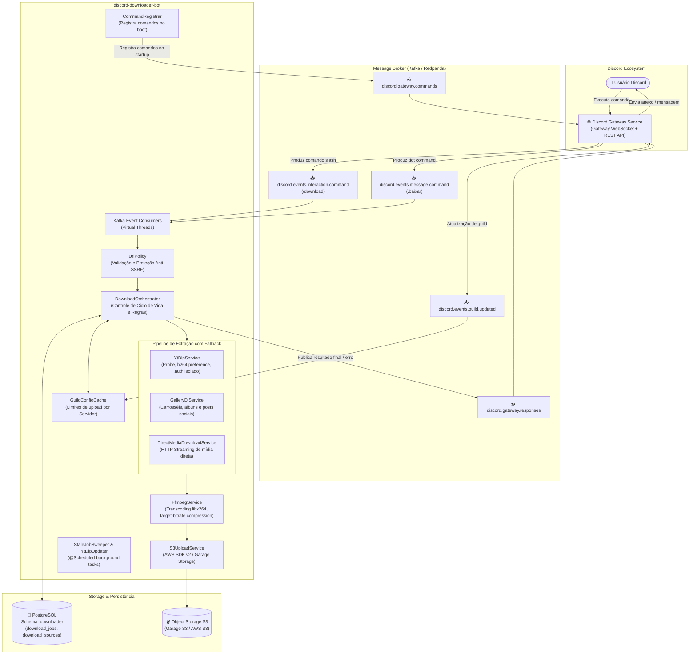
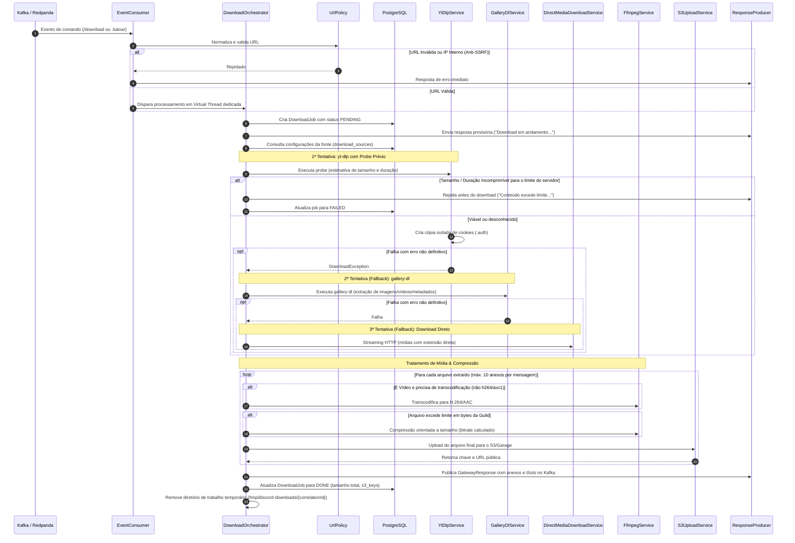

# discord-downloader-bot

Microserviço de alta performance em **Java 25** e **Spring Boot 4** projetado para processar downloads de mídia (vídeos, áudios, imagens, galerias e carrosséis) sob demanda a partir do ecossistema Discord.

O serviço opera de forma **100% assíncrona e orientada a eventos** via **Kafka / Redpanda**, totalmente desacoplado da Discord Gateway API (não há SDK ou bot token no classpath deste serviço). O processamento faz uso de **Virtual Threads (Project Loom)**, permitindo alta concorrência de I/O e processos externos sem bloqueio de carrier threads do sistema operacional.

---

## 📐 Blueprint da Arquitetura

### 1. Visão Geral da Arquitetura do Sistema



---

### 2. Fluxo Detalhado de Processamento & Pipeline de Fallback



---

## ✨ Funcionalidades e Alterações Recentes

### 🔄 Pipeline Triplo de Download com Fallback em Cadeia
1. **yt-dlp**: Download prioritário de vídeos de plataformas de streaming (YouTube, TikTok, Instagram, Twitter/X, Reddit, etc.) com probe inicial de metadados e seleção otimizada de formato H.264.
2. **gallery-dl**: Fallback automático caso o `yt-dlp` falhe, especializado em galerias, posts de redes sociais com imagens, carrosséis do Instagram e múltiplos anexos do Twitter/X, extraindo título e descrição originais via JSON de metadados.
3. **DirectMediaDownloadService**: Fallback secundário para URLs de mídia direta (extensões de imagens `.jpg, .png, .webp, .gif`, áudios `.mp3, .ogg, .flac` e vídeos `.mp4, .mkv, .mov`), realizando streaming HTTP nativo via `java.net.http.HttpClient` com aborto preventivo por excesso de tamanho.

### 🖼️ Suporte a Múltiplos Arquivos e Galerias
- Suporte nativo para posts contendo múltiplas mídias (carrosséis do Instagram e galerias do Twitter/X).
- O `DownloadResult` manipula coleções de arquivos (`allFiles()`).
- O sistema limita inteligentemente a entrega a até **10 arquivos por mensagem** (limite estrito da API do Discord) e realiza o upload indexado de cada mídia no bucket S3.

### 🍪 Isolamento de Cookies por Job (`.auth`)
- Para evitar condições de corrida (*race conditions*) e corrupção quando o `yt-dlp` reescreve sessões ou cookies durante chamadas simultâneas, cada job cria uma cópia privada e isolada do arquivo de cookies dentro de `/tmp/discord-downloads/{correlationId}/.auth/`. O arquivo mestre compartilhado permanece estritamente protegido e intacto.

### 🛡️ Classificação Refinada de Erros e Proteção de Circuit Breakers
- **`SourceBlockedException`**: Captura respostas de rate limit (HTTP 429), exigência de login e desafios de bot (Cloudflare/Checkpoint). Configurado no Resilience4j como exceção ignorada para não gerar retentativas inúteis quando a plataforma estiver bloqueando ativamente a requisição.
- **`ContentUnavailableException`**: Captura mídias removidas, privadas ou inexistentes (HTTP 404/410), fornecendo mensagem amigável ao usuário sem degradar o circuit breaker.
- **`DownloadInterruptedException` / Timeout**: Timeout de processamento (padrão de 240s) controlado por `ScheduledExecutorService` em virtual threads com interrupção e limpeza imediata dos processos CLI.

### ⚡ Otimização de Formatos H.264 (Zero Re-encode)
- Migrações Flyway atualizadas (`V8__prefer_h264_formats.sql` e `V9__support_all_media_types.sql`) instruem o `yt-dlp` a preferir codecs `avc1/h264` nativos de servidores remotos, permitindo pular totalmente a transcodificação de CPU via FFmpeg na maioria dos downloads.

### 🔒 Proteção Avançada Anti-SSRF (`UrlPolicy`)
- Validação estrita de esquemas permitidos (`http`, `https`).
- Sanitização de spoilers (`||url||`) e formatações do Discord (`<url>`).
- Resolução e validação de endereços IP para barrar acessos a redes internas, loopback (`127.0.0.1`), endereços locais (`10.0.0.0/8`, `172.16.0.0/12`, `192.168.0.0/16`), CGNAT (`100.64.0.0/10`) e metadados de cloud providers (`169.254.169.254`).

### 🧹 Limpeza Automática & Manutenção Contínua
- **`StaleJobSweeper`**: Varredura agendada no boot e a cada 10 minutos para marcar como `FAILED` jobs órfãos que foram interrompidos por reinicialização do pod/container.
- **`YtDlpUpdater`**: Cron diário (04:00 AM) para atualizar automaticamente as ferramentas CLI (`yt-dlp[default,curl-cffi]` e `gallery-dl`) contra quebras de API das plataformas externas.

---

## 🛠️ Tecnologias e Stack

| Camada | Tecnologia |
|---|---|
| **Linguagem & Runtime** | Java 25 (LTS) com Virtual Threads habilitadas, GraalVM JDK 25 |
| **Framework Base** | Spring Boot 4.0.6 (Spring Data JPA, Spring Kafka, Actuator) |
| **Mensageria** | Apache Kafka / Redpanda (`spring-kafka` com `VirtualThreadTaskExecutor`) |
| **Banco de Dados** | PostgreSQL 16+ com migrações gerenciadas pelo Flyway |
| **Storage de Mídia** | AWS SDK v2 para Java (`software.amazon.awssdk:s3`), compatível com Garage S3 e AWS S3 |
| **Extração de Mídia** | `yt-dlp` (com `curl-cffi` e `deno`), `gallery-dl`, `DirectMediaDownloadService` |
| **Processamento de Mídia** | `ffmpeg` / `ffprobe` (via `ProcessRunner` customizado) |
| **Resiliência** | Resilience4j (Circuit Breakers, Retries exponenciais, Bulkheads) |
| **Observabilidade** | Micrometer, Prometheus, OpenTelemetry (Tracing distribuído OTLP) |
| **Configuração & Segredos** | Spring Cloud Consul Config e suporte a segredos via arquivos montados (HashiCorp Vault) |

---

## 📬 Contrato de Tópicos Kafka

### Tópicos Inbound (Consumidos)

| Tópico | Payload / Formato | Descrição |
|---|---|---|
| `discord.events.interaction.command` | JSON (`DiscordEventPayload`) com header `command-name: download` | Comandos de barra (`/download link: <url> qualidade: [1080p, 720p...]`) |
| `discord.events.message.command` | JSON (`DiscordEventPayload`) com header `command-name: baixar` | Comandos por texto (`.baixar <url>`) |
| `discord.events.guild.updated` | JSON (`GuildUpdatedEvent`) | Atualização em tempo real de limites de arquivo por servidor Discord |

### Tópicos Outbound (Publicados)

| Tópico | Payload / Formato | Descrição |
|---|---|---|
| `discord.gateway.responses` | JSON (`GatewayResponse`) | Mensagens de progresso, mensagens de erro e entrega final das mídias com links S3 e nomes de arquivo |
| `discord.gateway.commands` | JSON | Registro automático de comandos de barra e prefixo disparado no startup do microserviço |

---

## 🛡️ Resiliência (Resilience4j)

Configuração ajustada e isolada por operação em `application.yaml`:

| Instância | Tipo | Configurações Principais | Exceções Ignoradas |
|---|---|---|---|
| `ytdlp` | Circuit Breaker | Window: 10, Falha: 50%, Espera Aberto: 30s | `ContentUnavailableException`, `SourceBlockedException`, `DownloadInterruptedException`, `BulkheadFullException` |
| `ytdlpRetry` | Retry | Max: 2 tentativas, Espera: 2s (backoff x2) | As mesmas acima |
| `ytdlpBulkhead` | Bulkhead | Máx Concorrentes: 15, Max Wait: 30s | — |
| `gallerydl` | Circuit Breaker | Window: 10, Falha: 50%, Espera Aberto: 30s | As mesmas de indisponibilidade e bloqueio |
| `gallerydlRetry` | Retry | Max: 2 tentativas, Espera: 2s (backoff x2) | As mesmas de indisponibilidade e bloqueio |
| `gallerydlBulkhead`| Bulkhead | Máx Concorrentes: 15, Max Wait: 30s | — |
| `ffmpeg` | Circuit Breaker | Window: 10, Falha: 50%, Espera Aberto: 30s | `ContentUnavailableException`, `DownloadInterruptedException` |
| `ffmpegBulkhead` | Bulkhead | Máx Concorrentes: 8, Max Wait: 30s | — |
| `s3Upload` | Circuit Breaker | Window: 10, Falha: 50%, Espera Aberto: 60s | — |
| `s3Retry` | Retry | Max: 3 tentativas, Espera: 1s (backoff x2) | — |

---

## 📊 Métricas e Observabilidade

Métricas expostas no endpoint do Actuator:
```
GET /actuator/prometheus
```

### Métricas de Negócio Registradas

- `downloader.job.in_flight` *(Gauge)*: Quantidade de jobs de download sendo processados simultaneamente.
- `downloader.job.started` *(Counter, tags: `source_host`, `qualidade`)*: Disparos de jobs iniciados.
- `downloader.job.completed` *(Counter, tags: `source_host`, `qualidade`)*: Downloads concluídos com sucesso.
- `downloader.job.failed` *(Counter, tags: `source_host`, `qualidade`, `reason`)*: Falhas classificadas por causa (`too_large`, `too_long`, `SourceBlockedException`, `ContentUnavailableException`, etc.).
- `downloader.job.duration` *(Timer, tags: `source_host`, `qualidade`)*: Tempo total de processamento desde a recepção até o upload no S3.
- `downloader.file.size` *(DistributionSummary, tags: `source_host`)*: Distribuição do tamanho em bytes dos arquivos enviados.
- `downloader.job.rejected` *(Counter, tag: `reason`)*: URLs inválidas ou barradas por SSRF.
- `downloader.job.duplicate` *(Counter)*: Mensagens duplicadas com mesmo `correlation_id`.
- `downloader.job.stale` *(Counter)*: Jobs órfãos expurgados pelo `StaleJobSweeper`.

### Health Indicators Customizados

Expostos em `/actuator/health`:
- `ffmpeg`: Executa `ffmpeg -version` com validação de binário funcional.
- `ytDlp`: Executa `yt-dlp --version` e expõe a versão instalada.
- `s3`: Executa `headBucket` no bucket configurado do S3/Garage.

---

## 🗄️ Modelo de Dados (Flyway Migrations)

O banco de dados PostgreSQL utiliza o schema `downloader`:

### Tabela `download_sources`
Registra regras de extração por domínio/host, permitindo ajustes dinâmicos sem novo deploy:
- `host`: Ex. `youtube.com`, `tiktok.com`, `instagram.com`, `x.com`.
- `format_selector`: Expressão de formato para o `yt-dlp`.
- `extra_args`: Argumentos extras de linha de comando (ex.: `--cookies`, `--merge-output-format`).
- `requires_auth` & `enabled`: Flags de controle.

### Tabela `download_jobs`
Histórico de execuções para auditoria e rastreamento:
- `correlation_id`: Identificador único da mensagem/interação.
- `guild_id`, `user_id`, `url`, `source_host`, `qualidade`.
- `status`: `PENDING`, `DOWNLOADING`, `ENCODING`, `UPLOADING`, `DONE`, `FAILED`.
- `file_size_bytes`, `s3_key`, `error_message`, `created_at`, `completed_at`.

### Tabela `guild_configs`
Configurações personalizadas por servidor Discord:
- `guild_id`: Identificador da guilda.
- `max_file_size_bytes`: Limite máximo em bytes para uploads (respeita planos Discord Nitro / Boost do servidor).

---

## 🚀 Como Executar

### Pré-requisitos
- **Java 25** (Oracle GraalVM JDK 25 ou Eclipse Temurin 25)
- **Docker** ou **Podman**
- Binários CLI instalados localmente se for executar fora de container:
  - `ffmpeg` e `ffprobe`
  - `yt-dlp` (com suporte a `curl-cffi`)
  - `gallery-dl`
  - `deno` (recomendado para desafios JavaScript do YouTube)

### Variáveis de Ambiente Principais

| Variável | Valor Padrão | Descrição |
|---|---|---|
| `SPRING_KAFKA_BOOTSTRAP_SERVERS` | `redpanda.redpanda.svc.cluster.local:9093` | Endereço dos brokers Kafka / Redpanda |
| `SPRING_DATASOURCE_URL` | — | JDBC URL do PostgreSQL (`jdbc:postgresql://...`) |
| `SPRING_DATASOURCE_USERNAME` | — | Usuário do banco de dados |
| `SPRING_DATASOURCE_PASSWORD` | — | Senha do banco de dados |
| `GATEWAY_GARAGE_ENDPOINT` | `http://garage.garage.svc.cluster.local:3900` | Endpoint do S3 / Garage |
| `GATEWAY_GARAGE_BUCKET` | `discord-gateway-attachments` | Nome do bucket S3 |
| `GARAGE_ACCESS_KEY` | — | Access Key do S3 |
| `GARAGE_SECRET_KEY` | — | Secret Key do S3 |
| `FFMPEG_THREADS` | `2` | Número de threads para transcodificação de CPU |
| `OTEL_EXPORTER_OTLP_ENDPOINT` | `http://localhost:4318/v1/traces` | Endpoint do coletor OpenTelemetry |

### Compilação e Testes

```bash
# Rodar suíte de testes unitários e de integração
./gradlew test

# Gerar JAR da aplicação
./gradlew bootJar
```

### Execução Local

```bash
./gradlew bootRun
```

### Build e Execução via Docker

A imagem Docker oficial utiliza build multi-stage com **Oracle GraalVM JDK 25**, base **Ubuntu Noble**, ZGC habilitado e todas as ferramentas de mídia empacotadas:

```bash
# Construir a imagem Docker
docker build -t discord-downloader-bot .

# Executar o container
docker run -d \
  --name discord-downloader \
  -p 8080:8080 \
  -e SPRING_KAFKA_BOOTSTRAP_SERVERS="seu-kafka:9092" \
  -e SPRING_DATASOURCE_URL="jdbc:postgresql://seu-postgres:5432/botdb" \
  -e SPRING_DATASOURCE_USERNAME="postgres" \
  -e SPRING_DATASOURCE_PASSWORD="senha" \
  -e GATEWAY_GARAGE_ENDPOINT="https://seu-s3-endpoint" \
  -e GARAGE_ACCESS_KEY="sua-key" \
  -e GARAGE_SECRET_KEY="seu-secret" \
  discord-downloader-bot
```
