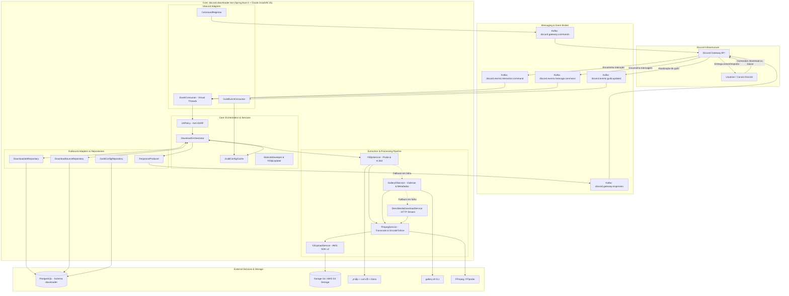
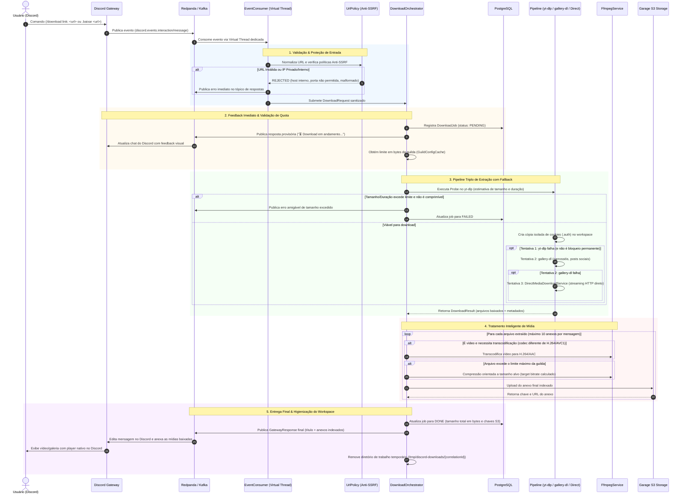

[](https://openjdk.org/)
[-JDK%2025-red?logo=graalvm)](https://www.graalvm.org/)
[](https://spring.io/projects/spring-boot)
[](https://kafka.apache.org/)
[](https://www.postgresql.org/)
[](https://resilience4j.readme.io/)
[](https://github.com/yt-dlp/yt-dlp)
[](https://ffmpeg.org/)

O **discord-downloader-bot** é um microserviço de alta performance, assíncrono e orientado a eventos projetado para processar downloads e transcodificação sob demanda de mídias (vídeos, áudios, imagens, galerias e carrosséis) a partir do ecossistema Discord. Desenvolvido sobre o **Java 25 com Oracle GraalVM (GFTC)** e **Spring Boot 4**, ele adota concorrência massiva baseada em **Virtual Threads (Project Loom)** e comunicação desacoplada via **Kafka / Redpanda**.

O bot conta com um **pipeline triplo de extração com fallback automático** (`yt-dlp` ➔ `gallery-dl` ➔ `Direct HTTP Streaming`), transcodificação adaptativa inteligente e compressão orientada a tamanho alvo via **FFmpeg**, isolamento de credenciais por job, proteção corporativa **anti-SSRF** e resiliência multicamadas com **Resilience4j**.

---

O sistema opera de forma totalmente desacoplada do Discord: um gateway externo escuta a API de Gateway do Discord e publica eventos brutos no Kafka. O `discord-downloader-bot` consome os eventos, processa o download e o tratamento de mídia em background e publica as respostas prontas com links indexados do **S3 (Garage Storage)** nos tópicos de saída.



---

## ⚡ Fluxo de Execução Ponta a Ponta

Cada solicitação de download segue um pipeline rigoroso de validação, feedback instantâneo, extração com fallback, transcodificação adaptativa e entrega estruturada:



---

## 🛠️ Pipeline de Extração e Ferramentas

O microserviço combina múltiplos utilitários especializados com mecanismos de fallback ordenados para maximizar a taxa de sucesso de download:

| Ferramenta / Serviço | Especialidade | Mecanismo & Otimizações | Resiliência & Tratamento |
|---|---|---|---|
| **`YtDlpService`** | Vídeos de plataformas de streaming (YouTube, TikTok, Twitter/X, Instagram, Reddit, etc.) | - **Pre-probe** de duração e tamanho sem download prévio<br>- Preferência explícita por formatos `avc1/h264` (elimina re-encode)<br>- Isolamento de cookies privados em `.auth`<br>- Suporte a Deno para desafios JS | **CircuitBreaker** (30s) + **Bulkhead** (15 chamadas) + **Retry** (2x com backoff exp). Ignora `SourceBlockedException` e `ContentUnavailableException` |
| **`GalleryDlService`** | Carrosséis de fotos/vídeos, álbuns e posts em redes sociais | - Extração de múltiplos arquivos por post<br>- Extração de metadados JSON (título e descrição originais)<br>- Cópia privada de cookies por job | **CircuitBreaker** (30s) + **Bulkhead** (15 chamadas) + **Retry** (2x). Acionado automaticamente em caso de falha do yt-dlp |
| **`DirectMediaDownloadService`** | Mídias com links diretos (`.mp4`, `.mp3`, `.png`, `.jpg`, `.webp`, `.gif`, etc.) | - Streaming HTTP nativo com `java.net.http.HttpClient`<br>- Validação de cabeçalhos `Content-Length`<br>- Interrupção preventiva caso exceda a quota máxima | Timeout configurável por job, proteção anti-SSRF e sem dependência de processos externos |
| **`FfmpegService`** | Transcodificação, compressão inteligente e detecção de mídia | - Transcodificação para H.264 / AAC com preset `veryfast`<br>- Cálculo matemático de taxa de bits (`targetVideoBitrate`) para caber na quota do servidor (`encodeToSize`)<br>- Detecção precisa de imagens/áudios para evitar transcode indevido | **CircuitBreaker** (30s) + **Bulkhead** (8 chamadas simultâneas de CPU) |
| **`S3UploadService`** | Armazenamento de alta performance e disponibilidade | - Upload via AWS SDK v2 para Garage S3 / AWS S3<br>- Chaves estruturadas por Guild e Correlation ID<br>- URLs públicas geradas para entrega no Discord | **CircuitBreaker** (60s) + **Retry** (3x com backoff exponencial) |

---

## 🛡️ Segurança Corporativa e Proteção Anti-SSRF (`UrlPolicy`)

Ao receber URLs submetidas por usuários do Discord, o bot aplica validação preventiva contra **Server-Side Request Forgery (SSRF)** e ataques de injeção de argumentos:

1. **Validação e Resolução Estrita de IPs (`UrlPolicy.isInternal`)**:
   - Resolução DNS inspecionada antes de delegar a qualquer processo ou HTTP client.
   - Bloqueio imediato de endereços:
     - **Loopback**: `127.0.0.0/8`, `::1`
     - **Redes Privadas RFC 1918**: `10.0.0.0/8`, `172.16.0.0/12`, `192.168.0.0/16`
     - **Link-Local & Cloud Metadata**: `169.254.0.0/16` (bloqueia acesso a endpoints de metadados como AWS/GCP `169.254.169.254`), `fe80::/10`
     - **Carrier-Grade NAT (CGNAT)**: `100.64.0.0/10`
     - **Unique-Local IPv6 & Multicast**: `fc00::/7`, `224.0.0.0/4`, `ff00::/8`
2. **Proteção contra Injeção de Argumentos de CLI**:
   - Rejeição imediata de URLs iniciando com traço (`-`), impedindo injeção de parâmetros em binários CLI (`yt-dlp` e `gallery-dl`).
3. **Restrição Estrita de Esquemas e Credenciais**:
   - Permite unicamente os esquemas `http` e `https`. Credenciais embutidas na URL (`user:pass@host`) são terminantemente recusadas.
4. **Sanitização de Formatações Discord**:
   - Remove automaticamente delimitadores de spoiler (`||url||`) e formatações de suppress-embed (`<url>`) comuns no Discord.

---

## 🔄 Resiliência e Tolerância a Falhas

- **Classificação Refinada de Exceções**:
  - `SourceBlockedException`: Disparada ao detectar rate limits (HTTP 429), captchas e exigência de login. Declarada como *ignored* no Resilience4j para evitar retentativas fúteis e não degradar o circuito do serviço quando a plataforma externa estiver bloqueando requisições.
  - `ContentUnavailableException`: Identifica vídeos privados, removidos ou páginas inexistentes (HTTP 404/410), notificando o usuário amigavelmente sem contabilizar como falha de infraestrutura.
- **Isolamento de Cookies por Workspace (`.auth`)**:
  - Arquivos de sessão compartilhados nunca são acessados em modo de escrita simultânea; cada processo trabalha em uma cópia privada isolada.
- **Controle de Timeout Atômico**:
  - `ScheduledExecutorService` configurado com Virtual Threads interrompe a thread de trabalho e encerra processos CLI caso excedam `downloader.processing-timeout-seconds` (padrão 240s), garantindo limpeza imediata do disco temporário.
- **Expurgo Automático de Jobs Órfãos (`StaleJobSweeper`)**:
  - Varredura agendada no boot e a cada 10 minutos que marca jobs interrompidos por reinicializações de container como `FAILED`.
- **Drenagem Graciosa no Desligamento (Graceful Shutdown)**:
  - O `DownloadOrchestrator` implementa `DisposableBean` com trava `drainLock`, aguardando a finalização dos downloads em trânsito antes de encerrar o processo.

---

## ⚡ Runtime de Alta Performance com Oracle GraalVM (GFTC) e Java 25

O serviço é compilado e executado sobre o **Oracle GraalVM JDK 25** sob a licença **GFTC (GraalVM Free Terms and Conditions)**, aproveitando as otimizações enterprise da JVM para microserviços orientados a I/O e alta concorrência:

```dockerfile
ARG GRAALVM_IMAGE=container-registry.oracle.com/graalvm/jdk:25
```

- **Oracle GraalVM Enterprise JIT**:
  - `-XX:+UnlockExperimentalVMOptions -XX:+EnableJVMCI -XX:+UseJVMCICompiler`: Ativa o compilador GraalVM JIT no topo da JVM.
  - `-Djdk.graal.CompilerConfiguration=enterprise`: Habilita a suíte de otimizações enterprise da Oracle para throughput máximo.
  - `-Djdk.graal.Vectorization=true`: Vetorização SIMD automática para aceleração de buffers de I/O e manipulação de payloads JSON.
  - `-Djdk.graal.UsePriorityInlining=true`: Heurística avançada de inlining por prioridade, aplanando cadeias funcionais e closures em Virtual Threads.
  - `-XX:+TieredCompilation`: Tier 1-3 (C1) para inicialização ultrarrápida do container + Tier 4 (GraalVM) para processamento estável.
- **Generational ZGC (`-XX:+UseZGC`)**: Coletor de lixo ultrarrápido com pausas garantidas abaixo de 1 milissegundo, eliminando congelamentos durante processamento intensivo de streams e I/O.
- **Compact Object Headers (`-XX:+UseCompactObjectHeaders`)**: Redução substancial de footprint de memória em objetos Java 25.
- **Ergonomia de Memória para Subprocessos (`FFmpeg` / `yt-dlp`)**: Limite da Heap balanceado (`MaxRAMPercentage=65%`, `InitialRAMPercentage=30%`), reservando folga de memória no container para os binários nativos executados fora da JVM.
- **DNS Dinâmico no Kubernetes**: Cache de DNS configurado com TTL de 30s (`networkaddress.cache.ttl=30`) para resolução dinâmica de serviços (Consul, Redpanda, Garage).
- **Virtual Threads (Project Loom)**: Ativadas globalmente (`spring.threads.virtual.enabled: true`), permitindo que chamadas síncronas de subprocessos (`ProcessRunner.waitFor()`) e transferências S3 escalem centenas de jobs simultâneos sem sobrecarregar threads do SO.
- **Atualização Automática de Ferramentas CLI**: O `YtDlpUpdater` roda diariamente via cron (`0 0 4 * * *`) executando atualização in-place de `yt-dlp` e `gallery-dl` via `pip3`, mantendo paridade com mudanças constantes nas APIs das plataformas de streaming.

---

## 📋 Comandos Disponíveis no Discord

| Comando | Tipo | Visibilidade | Descrição |
|---|---|---|---|
| `/download link: <url> [qualidade]` | Slash Command | Pública | Baixa mídias de qualquer plataforma com opção de qualidade (`original`, `1080p`, `720p`, `480p`, `360p`). |
| `.baixar <url>` | Mensagem / Prefixo | Pública | Comando rápido via chat de texto (qualidade `original` padrão). |

Os comandos são anunciados e registrados automaticamente no cluster Discord durante a inicialização da aplicação pelo `CommandRegistrar`.

---

## 📬 Contrato de Tópicos Kafka

### Tópicos Inbound (Consumidos)

| Tópico | Payload / Formato | Descrição |
|---|---|---|
| `discord.events.interaction.command` | JSON (`DiscordEventPayload`) | Consome comandos slash (`/download`). |
| `discord.events.message.command` | JSON (`DiscordEventPayload`) | Consome comandos de prefixo (`.baixar`). |
| `discord.events.guild.updated` | JSON (`GuildUpdatedEvent`) | Consome atualizações em tempo real de limites de upload dos servidores. |

### Tópicos Outbound (Publicados)

| Tópico | Payload / Formato | Descrição |
|---|---|---|
| `discord.gateway.responses` | JSON (`GatewayResponse`) | Publica respostas de status provisório, mensagens de erro e anexos finais. |
| `discord.gateway.commands` | JSON | Publica a especificação dos comandos no startup para registro dinâmico no Gateway. |

---

## 📊 Métricas e Observabilidade

O serviço expõe métricas completas no padrão Prometheus e traces via OpenTelemetry:

- **Endpoint Prometheus**: `GET /actuator/prometheus`
- **Distributed Tracing**: Exportação de spans OTLP com amostragem total (`probability: 1.0`) para tracing ponta a ponta.
- **Health Indicators**: `GET /actuator/health` com verificações ativas de `ffmpeg`, `ytDlp`, `s3` e probes de liveness/readiness.

### Métricas de Negócio Registradas (Micrometer)

| Métrica | Tipo | Tags | Descrição |
|---|---|---|---|
| `downloader.job.in_flight` | Gauge | — | Quantidade de downloads sendo processados em tempo real. |
| `downloader.job.started` | Counter | `source_host`, `qualidade` | Total de jobs iniciados. |
| `downloader.job.completed` | Counter | `source_host`, `qualidade` | Total de jobs concluídos com sucesso. |
| `downloader.job.failed` | Counter | `source_host`, `qualidade`, `reason` | Total de jobs que falharam por motivo catalogado. |
| `downloader.job.duration` | Timer | `source_host`, `qualidade` | Duração ponta a ponta do processamento. |
| `downloader.file.size` | DistributionSummary | `source_host` | Distribuição de tamanho em bytes dos arquivos enviados. |
| `downloader.job.rejected` | Counter | `reason` | Solicitações rejeitadas por URL inválida ou SSRF. |
| `downloader.job.duplicate` | Counter | — | Eventos duplicados ignorados por idempotência. |
| `downloader.job.stale` | Counter | — | Jobs órfãos expurgados após reinicializações. |

---

## ⚙️ Variáveis de Ambiente e Configurações

| Variável | Padrão | Descrição |
|---|---|---|
| `SPRING_KAFKA_BOOTSTRAP_SERVERS` | `redpanda.redpanda.svc.cluster.local:9093` | Endereço dos brokers Kafka / Redpanda. |
| `SPRING_DATASOURCE_URL` | — | JDBC URL do PostgreSQL (`jdbc:postgresql://host:5432/db`). |
| `SPRING_DATASOURCE_USERNAME` | — | Usuário do banco de dados PostgreSQL. |
| `SPRING_DATASOURCE_PASSWORD` | — | Senha do banco de dados PostgreSQL. |
| `GATEWAY_GARAGE_ENDPOINT` | `http://garage.garage.svc.cluster.local:3900` | Endpoint do serviço de Object Storage S3 / Garage. |
| `GATEWAY_GARAGE_BUCKET` | `discord-gateway-attachments` | Nome do bucket S3 utilizado para os uploads. |
| `GARAGE_ACCESS_KEY` / `GARAGE_SECRET_KEY` | — | Credenciais de acesso ao bucket S3. |
| `GARAGE_REGION` | `garage` | Região configurada no S3. |
| `FFMPEG_THREADS` | `2` | Número de threads alocadas para transcodificação de CPU. |
| `HIKARI_MAX_POOL_SIZE` | `30` | Número máximo de conexões no pool HikariCP. |
| `BULKHEAD_YTDLP_MAX_CONCURRENT` | `15` | Limite de chamadas simultâneas ao yt-dlp. |
| `BULKHEAD_GALLERYDL_MAX_CONCURRENT` | `15` | Limite de chamadas simultâneas ao gallery-dl. |
| `BULKHEAD_FFMPEG_MAX_CONCURRENT` | `8` | Limite de codificações simultâneas de FFmpeg. |
| `OTEL_EXPORTER_OTLP_ENDPOINT` | `http://localhost:4318/v1/traces` | Endpoint do coletor OpenTelemetry (OTLP). |
| `SPRING_CLOUD_CONSUL_HOST` | `consul-server.consul.svc.cluster.local` | Host do HashiCorp Consul para externalização de configurações. |

---

## 🚀 Como Executar

### Pré-requisitos
- **JDK 25** (Oracle GraalVM JDK 25 ou Eclipse Temurin 25)
- **Docker** / **Podman**
- Binários CLI instalados localmente para execuções fora de container:
  - `ffmpeg` e `ffprobe`
  - `yt-dlp` (com suporte a `curl-cffi`)
  - `gallery-dl`
  - `deno` (recomendado para resolução de desafios JavaScript)

### Build e Testes

```bash
# Executar a suíte de testes unitários e de integração
./gradlew test

# Compilar e gerar o arquivo JAR executável
./gradlew bootJar
```

### Execução Local via Gradle

```bash
./gradlew bootRun
```

### Construção e Execução via Docker

```bash
# Construir imagem Docker multi-stage com GraalVM 25 e CLI tools
docker build -t discord-downloader-bot:latest .

# Executar o container
docker run -d \
  --name discord-downloader-bot \
  -p 8080:8080 \
  -e SPRING_KAFKA_BOOTSTRAP_SERVERS="localhost:9092" \
  -e SPRING_DATASOURCE_URL="jdbc:postgresql://localhost:5432/discord_bot" \
  -e SPRING_DATASOURCE_USERNAME="postgres" \
  -e SPRING_DATASOURCE_PASSWORD="senha" \
  -e GATEWAY_GARAGE_ENDPOINT="http://localhost:3900" \
  -e GATEWAY_GARAGE_BUCKET="discord-gateway-attachments" \
  -e GARAGE_ACCESS_KEY="sua_access_key" \
  -e GARAGE_SECRET_KEY="sua_secret_key" \
  discord-downloader-bot:latest
```
