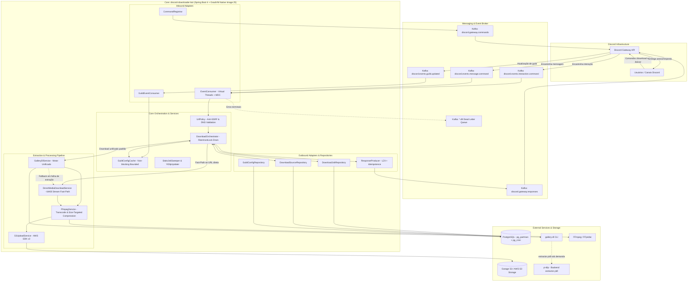
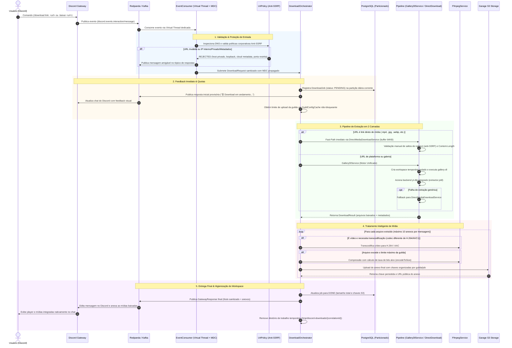

[](https://openjdk.org/)
[](https://www.graalvm.org/)
[](https://spring.io/projects/spring-boot)
[](https://redpanda.com/)
[](https://www.postgresql.org/)
[](https://www.vaultproject.io/)
[](https://github.com/yt-dlp/yt-dlp)
[](https://ffmpeg.org/)

O **discord-downloader-bot** é um microserviço de alta performance, assíncrono e orientado a eventos projetado para orquestrar downloads, extração de mídia e transcodificação sob demanda no ecossistema Discord. Compilado para **GraalVM Native Image (AOT)** sobre o **Java 25** e **Spring Boot 4**, o serviço oferece inicialização instantânea, baixo consumo de memória e concorrência massiva baseada em **Virtual Threads (Project Loom)** com comunicação desacoplada via **Kafka / Redpanda**.

O serviço conta com uma **arquitetura de download em duas camadas** (`GalleryDlService` como motor unificado com backend `yt-dlp` e fallback/fast-path para `DirectMediaDownloadService`), transcodificação adaptativa inteligente via **FFmpeg**, particionamento nativo de banco de dados com **`pg_partman`** e **`pg_cron`**, container com **filesystem raiz 100% somente leitura (`readOnlyRootFilesystem: true`)**, proteção corporativa **anti-SSRF** e resiliência multicamadas.

---

## 🏛️ Visão Geral da Arquitetura

O sistema opera de forma totalmente desacoplada da conexão direta com o Discord: o gateway externo (`discord-gateway-api`) recebe as interações do Discord e publica eventos brutos no broker Kafka/Redpanda. O `discord-downloader-bot` consome os eventos via Virtual Threads, processa a extração e transcodificação de mídia, faz upload para o **Object Storage S3 (Garage Storage)** e publica as respostas prontas com links indexados nos tópicos de saída.



---

## ⚡ Fluxo de Execução Ponta a Ponta

Cada solicitação de download segue um pipeline estrito de validação, feedback em tempo real, extração com fallback, transcodificação adaptativa e entrega estruturada:



---

## 🗄️ PostgreSQL Avançado (`pg_partman` e `pg_cron`)

A camada de persistência foi desenhada para altíssima volumetria de escrita e expurgo sem sobrecarga de I/O ou bloqueios de tabela:

- **Particionamento Declarativo Diário:**
  - A tabela `downloader.download_jobs` utiliza particionamento nativo por intervalo diário baseado na coluna `created_at` (`PARTITION BY RANGE (created_at)`), com uma partição de contingência `downloader.download_jobs_default`.
  - A chave primária é composta por `(id, created_at)` para viabilizar *partition pruning* estático e dinâmico na árvore de execução do PostgreSQL.
- **Automação de Partições e Retenção (`pg_partman` 5.5.0):**
  - Gerenciamento automático de partições diárias com `premake = 3` (criação antecipada de 3 partições futuras).
  - Retenção estrita de **30 dias** (`retention = '30 days'`, `retention_keep_table = false`), eliminando partições expiradas via `DROP TABLE` em nível de filesystem — operação quase instantânea com custo zero de `VACUUM`.
  - Storage parameter `fillfactor = 85` configurado na template table (`partman.template_downloader_download_jobs`), reservando espaço nas páginas de dados para transições frequentes de status (`PENDING` ➔ `DOWNLOADING` ➔ `ENCODING` ➔ `UPLOADING` ➔ `DONE`) sem quebrar ponteiros de índice via otimização **HOT (Heap-Only Tuples)**.
- **Agendador Nativo de Banco de Dados (`pg_cron`):**
  - Manutenção periódica registrada no `pg_cron` executando de hora em hora (`30 * * * *`) chamando `SELECT partman.run_maintenance(p_analyze := FALSE)`.
  - Comunicação via socket Unix `/controller/run`, garantindo execução isolada e confiável dentro do cluster PostgreSQL (CloudNative-PG).
- **Estratégia de Indexação Local:**
  - `idx_download_jobs_correlation_id`: Índice B-Tree local por partição para busca pontual O(1) de idempotência e conferência de duplicatas.
  - `idx_download_jobs_active`: Índice parcial cobrindo apenas jobs em andamento (`WHERE status IN ('PENDING', 'DOWNLOADING', 'ENCODING', 'UPLOADING')`), mantendo tamanho irrisório e acelerando varreduras de jobs pendentes.
- **Restrições de Integridade (Check Constraints):**
  - Constraints adicionadas em `downloader.guild_configs`:
    - `chk_guild_configs_boost_tier`: Garante `boost_tier BETWEEN 0 AND 3`.
    - `chk_guild_configs_file_size`: Garante `max_file_size_bytes > 0`.
    - `chk_guild_configs_bitrate`: Garante `max_bitrate_kbps > 0`.

---

## 📨 Mensageria Otimizada (Redpanda / Kafka)

A comunicação com o broker de mensageria utiliza configurações de resiliência e alto rendimento empresarial:

- **Produtor Transacional e Idempotente:**
  - `acks: all` e `enable.idempotence: true`: Garante entrega *exactly-once* sem duplicação no broker.
  - Compressão de alta velocidade `lz4`, reduzindo tráfego de rede e consumo de banda entre microserviços.
  - `batch.size: 32768` (32 KB) e `linger.ms: 5` para agregação eficiente de mensagens sob rajada.
- **Consumo Resiliente e Anti-Rebalance:**
  - `max-poll-records: 1`: Garante que cada worker consuma apenas um job por vez.
  - `max.poll.interval.ms: 900000` (15 minutos): Evita desconexões ou falsos rebalances do grupo durante downloads demorados de arquivos grandes ou transcodificações de vídeo.
  - `partition.assignment.strategy: CooperativeStickyAssignor`: Rebalances cooperativos incrementais sem interrupção de partições saudáveis.
  - `AckMode.RECORD`: Confirmação manual/individual por registro processado com sucesso.
- **Dead Letter Topic (DLT):**
  - `DeadLetterPublishingRecoverer` com roteador para `<topico>.dlt`, capturando payloads malformados ou falhas não recuperáveis sem travar a fila.
- **Rastreabilidade Distribuída (MDC):**
  - Injeção contextual automática de `correlationId` e `guildId` no `MDC` com limpeza garantida via bloco `try-finally`, correlacionando logs do SLF4J, traces OpenTelemetry e mensagens Kafka.

---

## 🛠️ Pipeline de Extração e Ferramentas

| Ferramenta / Serviço | Especialidade | Mecanismo & Otimizações | Resiliência & Concorrência |
|---|---|---|---|
| **`GalleryDlService`** | Motor principal unificado: fotos, carrosséis, álbuns e vídeos de redes sociais e streaming (YouTube, TikTok, Twitter/X, Instagram, Reddit, etc.) | - **Backend unificado `yt-dlp`** via `extractor.ytdl.enabled=true` e `extractor.ytdl.module=yt_dlp`<br>- Preferência por formatos `avc1/h264`<br>- Proteção nativa contra vídeos gigantes via `--max-filesize` e filtro de duração em `raw-options`<br>- Limite seguro de itens em carrosséis (`--range 1-10`) e diretório plano (`-D ""`)<br>- Prefixação transparente `ytdl:` com retentativa automática em falhas do extrator nativo<br>- Cópia privada de cookies por job com repasse ao `yt-dlp` (`forward-cookies=true`) | **CircuitBreaker** (30s) + **Bulkhead** (15 chamadas) + **Retry** (2x com backoff exp). Interrupção imediata em `SourceBlockedException` e `ContentUnavailableException` sem retentativas fúteis |
| **`DirectMediaDownloadService`** | Fast-path para links diretos de mídia e fallback final para URLs simples (`.mp4`, `.mp3`, `.png`, `.jpg`, `.webp`, `.gif`, etc.) | - Fast-Path acionado diretamente antes de invocar subprocessos CLI<br>- Streaming HTTP nativo com `java.net.http.HttpClient` e `Redirect.NEVER`<br>- **Buffer de I/O de alta velocidade de 64 KB** (`65536 bytes`)<br>- Acompanhamento manual de até 5 saltos de redirect com re-inspeção DNS/anti-SSRF a cada salto (`UrlPolicy`)<br>- Validação antecipada de `Content-Length` e contagem atômica de bytes | Timeout configurável por job, proteção anti-SSRF e execução em Virtual Threads sem dependência de processos externos |
| **`FfmpegService`** | Transcodificação, compressão inteligente e detecção de mídia | - Transcodificação para H.264 / AAC com preset `veryfast`<br>- Detecção precisa de imagens estáticas e faixas puras de áudio para evitar transcodificação indevida de CPU<br>- Cálculo matemático de taxa de bits alvo (`targetVideoBitrate`) para caber na quota do servidor (`encodeToSize`) | **CircuitBreaker** (30s) + **Bulkhead** (8 chamadas simultâneas de CPU) |
| **`S3UploadService`** | Armazenamento de alta performance e disponibilidade | - Upload via AWS SDK v2 para Garage S3 / AWS S3<br>- Chaves estruturadas por Guild e Correlation ID<br>- URLs públicas geradas para entrega no Discord | **CircuitBreaker** (60s) + **Retry** (3x com backoff exponencial) |

---

## 🛡️ Segurança Corporativa, Hardening e Anti-SSRF

1. **Filesystem 100% Somente Leitura (`readOnlyRootFilesystem: true`):**
   - O container Kubernetes roda com o filesystem raiz totalmente imutável.
   - Os diretórios de sistema `/usr/local/bin`, `/usr/bin` e `/bin` pertencem exclusivamente ao usuário `root` e permanecem inalteráveis em tempo de execução.
2. **Ambiente de Dependências Python Dedicado e Seguro:**
   - Variável `PYTHONUSERBASE=/app/pydeps` apontando para volume temporário em memória (`emptyDir`).
   - O comando de auto-update `pip3 install` utiliza a flag `--only-binary :all:`, rejeitando pacotes com código arbitrário `setup.py` e aceitando exclusivamente binários pré-compilados (`.whl`).
   - O `YtDlpUpdater` roda via `ProcessRunner` com timeout rígido de 120 segundos, prevenindo bloqueio permanente de threads.
3. **Validação Rigorosa Anti-SSRF (`UrlPolicy`):**
   - Resolução DNS inspecionada antes de delegar requisições a qualquer componente.
   - Bloqueio imediato de endereços:
     - **Loopback**: `127.0.0.0/8`, `::1`
     - **Redes Privadas RFC 1918**: `10.0.0.0/8`, `172.16.0.0/12`, `192.168.0.0/16`
     - **Link-Local & Cloud Metadata**: `169.254.0.0/16` (bloqueia acesso a metadados AWS/GCP `169.254.169.254`), `fe80::/10`
     - **Carrier-Grade NAT (CGNAT)**: `100.64.0.0/10`
     - **Unique-Local IPv6 & Multicast**: `fc00::/7`, `224.0.0.0/4`, `ff00::/8`
4. **Proteção contra Injeção de Argumentos de CLI:**
   - Rejeição imediata de URLs iniciando com traço (`-`), impedindo flags maliciosas injetadas nos binários CLI.
5. **Acompanhamento Seguro de Redirecionamentos HTTP:**
   - Desativação do seguimento automático de redirects da JVM (`Redirect.NEVER`).
   - Acompanhamento manual limitado a 5 saltos, validando a conformidade de cada destino contra a `UrlPolicy` antes do próximo disparo.

---

## ⚡ Concorrência Não-Bloqueante e Clean Code

- **Virtual Threads (Project Loom):**
  - Ativadas globalmente (`spring.threads.virtual.enabled: true`), permitindo que chamadas síncronas de subprocessos CLI (`ProcessRunner.waitFor()`) e transferências S3 escalem centenas de jobs simultâneos com footprint mínimo.
- **`GuildConfigCache` Não-Bloqueante:**
  - Substituição de chamadas bloqueantes `ConcurrentHashMap.computeIfAbsent` por leituras livres de trava fora do bucket, eliminando contenção durante consultas JDBC/JPA.
  - Limite superior de 10.000 entradas para evitar vazamento gradual de memória.
- **`CachedHealth` Probe-Safe:**
  - Substituição de blocos `synchronized(this)` por `ReentrantLock.tryLock()`. Sob contenção de concorrência nas checagens do Kubernetes (liveness e readiness probes), o serviço retorna o status em cache recente de forma imediata sem enfileirar threads ou causar timeout nos probes.
- **Drenagem Graciosa com `ReentrantLock` & `Condition`:**
  - O `DownloadOrchestrator` implementa shutdown gracioso via `drainedCondition.awaitNanos(...)` e `signalAll()`, aguardando o término de downloads em trânsito com timeout de desligamento configurado em 250s (`spring.lifecycle.timeout-per-shutdown-phase: 250s`).
- **Controle de Cardinalidade de Métricas:**
  - Função `normalizeMetricHost` que agrupa URLs de milhares de domínios arbitrários em domínios conhecidos (`youtube.com`, `tiktok.com`, `instagram.com`, `twitter.com`, `reddit.com`, etc.) e converte o restante para a categoria delimitada `"other"`, blindando o Prometheus contra explosão de memória.
- **Código Limpo e Autodocumentado:**
  - Remoção integral de comentários e Javadocs desnecessários do código-fonte; métodos com responsabilidade única e semântica expressiva.

---

## 🚀 Runtime GraalVM Native Image (AOT)

O serviço é compilado nativamente via **GraalVM Native Build Tools (`nativeCompile`)** gerando um binário executável ELF nativo:

- **Startup Instantâneo:** Tempo de inicialização inferior a **1 segundo** no Kubernetes.
- **Consumo de Memória Reduzido:** Footprint de memória entre 40 MB e 90 MB em repouso.
- **Hints Nativos Customizados:** Implementação de `RuntimeHintsRegistrar` em `NativeRuntimeHints.java` registrando reflexão, serialização, recursos SQL de migração Flyway e classes dinâmicas do Hibernate, Consul, LZ4 e Kafka.

---

## 📋 Comandos Disponíveis no Discord

| Comando | Tipo | Visibilidade | Descrição |
|---|---|---|---|
| `/download link: <url> [qualidade]` | Slash Command | Pública | Baixa mídias de qualquer plataforma com opção de qualidade (`original`, `1080p`, `720p`, `480p`, `360p`). |
| `.baixar <url>` | Mensagem / Prefixo | Pública | Comando rápido via chat de texto (qualidade `original` padrão). |

Os comandos são sincronizados dinamicamente com o cluster Discord durante a inicialização pelo `CommandRegistrar`.

---

## 📬 Contrato de Tópicos Kafka

### Tópicos Inbound (Consumidos)

| Tópico | Payload / Formato | Descrição |
|---|---|---|
| `discord.events.interaction.command` | JSON (`DiscordEventPayload`) | Consome comandos slash (`/download`). |
| `discord.events.message.command` | JSON (`DiscordEventPayload`) | Consome comandos de prefixo (`.baixar`). |
| `discord.events.guild.updated` | JSON (`GuildUpdatedEvent`) | Consome atualizações em tempo real dos limites de upload dos servidores. |

### Tópicos Outbound (Publicados)

| Tópico | Payload / Formato | Descrição |
|---|---|---|
| `discord.gateway.responses` | JSON (`GatewayResponse`) | Publica respostas de status provisório, mensagens de erro e anexos finais. |
| `discord.gateway.commands` | JSON | Publica a especificação dos comandos no startup para registro dinâmico no Gateway. |
| `*.dlt` | JSON | Tópicos Dead-Letter para captura de mensagens com falhas terminais. |

---

## 📊 Métricas e Observabilidade

- **Endpoint Prometheus**: `GET /actuator/prometheus`
- **Distributed Tracing**: Exportação de spans OTLP com amostragem total (`probability: 1.0`).
- **Health Indicators**: `GET /actuator/health` com verificações em cache de `ffmpeg`, `galleryDl`, `s3` e probes de liveness/readiness.

### Métricas de Negócio (Micrometer)

| Métrica | Tipo | Tags | Descrição |
|---|---|---|---|
| `downloader.job.in_flight` | Gauge | — | Quantidade de downloads sendo processados em tempo real. |
| `downloader.job.started` | Counter | `source_host`, `qualidade` | Total de jobs iniciados. |
| `downloader.job.completed` | Counter | `source_host`, `qualidade` | Total de jobs concluídos com sucesso. |
| `downloader.job.failed` | Counter | `source_host`, `qualidade`, `reason` | Total de jobs que falharam por motivo catalogado. |
| `downloader.job.duration` | Timer | `source_host`, `qualidade` | Duração ponta a ponta do processamento. |
| `downloader.file.size` | DistributionSummary | `source_host` | Distribuição de tamanho em bytes dos arquivos enviados. |
| `downloader.job.rejected` | Counter | `reason` | Solicitações rejeitadas por URL inválida ou SSRF. |
| `downloader.job.duplicate` | Counter | — | Eventos duplicados ignorados por idempotência. |
| `downloader.job.stale` | Counter | — | Jobs órfãos expurgados após reinicializações. |

---

## ⚙️ Variáveis de Ambiente e Configurações

| Variável | Padrão | Descrição |
|---|---|---|
| `SPRING_KAFKA_BOOTSTRAP_SERVERS` | `redpanda.redpanda.svc.cluster.local:9093` | Endereço dos brokers Kafka / Redpanda. |
| `SPRING_DATASOURCE_URL` | — | JDBC URL do PostgreSQL (`jdbc:postgresql://host:5432/discord_downloader_bot`). |
| `SPRING_DATASOURCE_USERNAME` | — | Usuário do banco de dados PostgreSQL. |
| `SPRING_DATASOURCE_PASSWORD` | — | Senha do banco de dados PostgreSQL. |
| `GATEWAY_GARAGE_ENDPOINT` | `http://garage.garage.svc.cluster.local:3900` | Endpoint do serviço de Object Storage S3 (Garage). |
| `GATEWAY_GARAGE_BUCKET` | `discord-gateway-attachments` | Nome do bucket S3 utilizado para os uploads. |
| `GARAGE_ACCESS_KEY` / `GARAGE_SECRET_KEY` | — | Credenciais de acesso ao bucket S3. |
| `GARAGE_REGION` | `garage` | Região configurada no S3. |
| `FFMPEG_THREADS` | `2` | Número de threads alocadas para transcodificação de CPU. |
| `HIKARI_MAX_POOL_SIZE` | `30` | Número máximo de conexões no pool HikariCP. |
| `BULKHEAD_GALLERYDL_MAX_CONCURRENT` | `15` | Limite de chamadas simultâneas ao motor unificado gallery-dl. |
| `BULKHEAD_FFMPEG_MAX_CONCURRENT` | `8` | Limite de codificações simultâneas de FFmpeg. |
| `OTEL_EXPORTER_OTLP_ENDPOINT` | `http://localhost:4318/v1/traces` | Endpoint do coletor OpenTelemetry (OTLP). |
| `SPRING_CLOUD_CONSUL_HOST` | `consul-server.consul.svc.cluster.local` | Host do HashiCorp Consul para externalização de configurações. |

---

## 🚀 Como Executar e Compilar

### Pré-requisitos
- **JDK 25** (Oracle GraalVM JDK 25)
- **Docker** ou **Podman**
- Binários CLI para execuções locais: `ffmpeg`, `ffprobe`, `yt-dlp` (com `curl-cffi`), `gallery-dl`, `deno`.

### Testes e Build Local

```bash
# Executar a suíte de testes unitários e de integração (100% green)
./gradlew test

# Compilar o binário GraalVM Native Image localmente
./gradlew nativeCompile

# Gerar o JAR padrão alternativo
./gradlew bootJar
```

### Construção de Imagem Docker

```bash
# Compilar imagem Docker multi-stage com GraalVM Native Image
docker build -t ghcr.io/gdinizds/discord-downloader-bot:latest .
```
